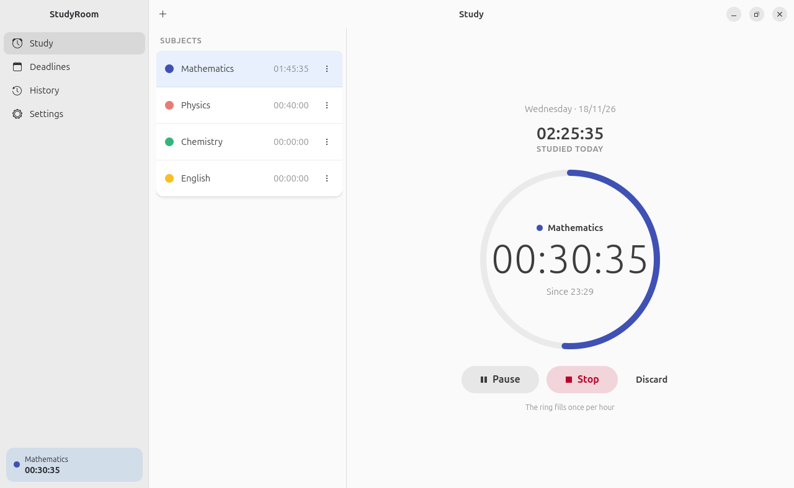
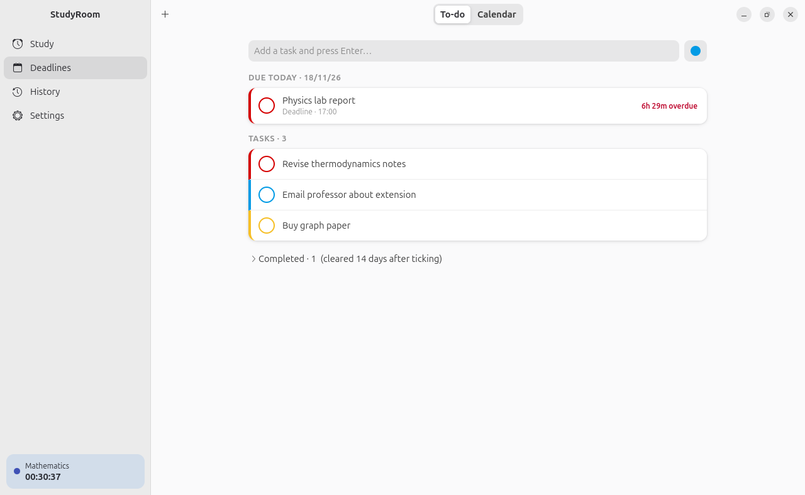
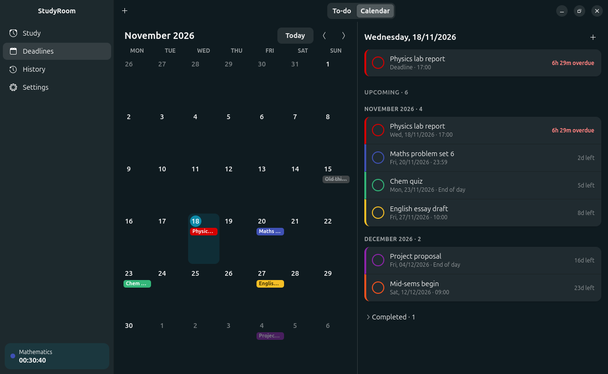
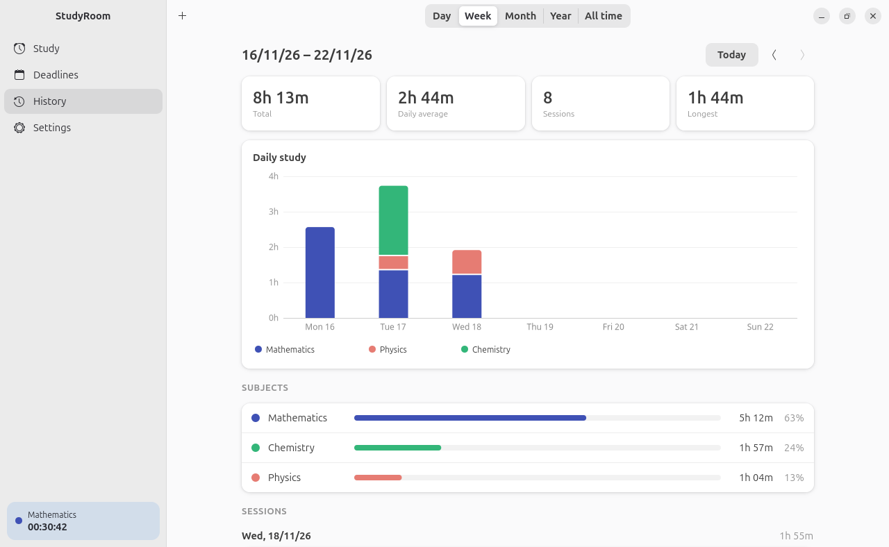
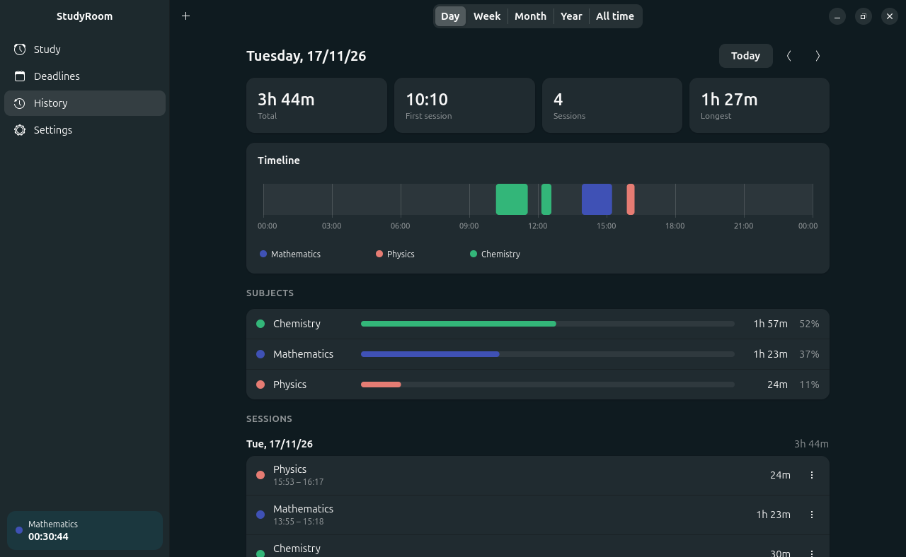
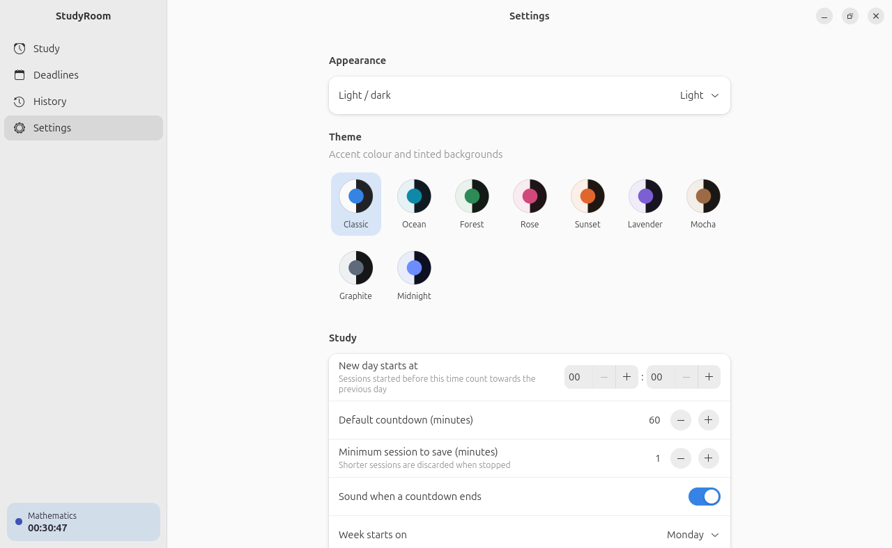
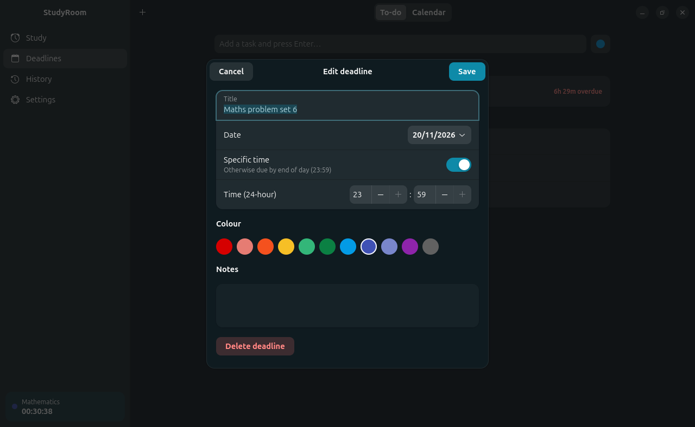

# StudyRoom

A clean, native study timer and deadline tracker for Ubuntu / GNOME, loosely inspired by the
mobile study-timer app *Yeolpumta (YPT)* — **without** any app or website blocking.

Time your study sessions per subject, see your history for all time, and keep your to-dos and deadlines
in the same place.



| | |
|---|---|
|  |  |
|  |  |
|  |  |

*Screenshots use made-up sample data.*

> **AI disclosure:** this project is entirely AI-generated, by Anthropic's Claude via Claude Code.
> See [AI_USAGE.md](AI_USAGE.md) for details.

---

## Features

**Study**
- Subjects with any colour (11 preset swatches or a custom colour); add, edit, reorder, erase.
- One button to **Start** (counts up — the default) and a separate **Countdown** button with a minutes box
  next to it. No pop-up asking which mode you want.
- Pause / resume, stop (saves the session), discard (doesn't).
- Big ring timer, today's total, and today's time per subject.
- The timer is based on timestamps, so it stays correct if you close the app, it crashes, or the
  laptop sleeps — it simply resumes next time.
- Closing the window mid-session lets you **keep timing in the background**.
- A finished countdown is saved automatically, with a notification and a sound.

**Deadlines**
- **To-do**: quick-add tasks (type, press Enter) in 11 colours. Deadlines due today appear at the top
  automatically.
- **Calendar**: month view with coloured chips, a list for the selected day, and an **Upcoming** list
  grouped by month with "2d 4h left" / "overdue" countdowns.
- Deadlines have a date and an optional time (otherwise due at the end of the day) plus notes.
- Ticked tasks and deadlines are **removed automatically 14 days after you tick them**, so the completed
  list doesn't grow forever.

**History**
- Day / Week / Month / Year / All time.
- Total, daily average, number of sessions, longest session.
- Stacked bar charts per day or month (hover for details), and a 24-hour timeline for a single day.
- Breakdown by subject, plus a full session list (delete a session, or add one you forgot to time).
- Erasing a subject **keeps** its past sessions in your history.

**Settings**
- Light / dark / follow system, and 9 colour themes (Classic, Ocean, Forest, Rose, Sunset, Lavender,
  Mocha, Graphite, Midnight).
- When a new "study day" starts (default 00:00 — e.g. set 05:00 so late-night sessions count towards
  the previous day).
- Default countdown length, minimum session length to save, countdown sound, week starts Monday/Sunday.
- Optional **top-bar timer** (a small GNOME Shell extension) showing the subject and live time, with
  Pause / Stop / Open in its menu.

**Conventions:** 24-hour time and day/month/year dates (DD/MM/YY; DD/MM/YYYY in the calendar), always from
your computer's own clock. Everything is stored locally — no accounts, no network, no telemetry.

---

## Requirements

- Linux with **GNOME** (developed and tested on Ubuntu 26.04, GNOME 50, Wayland).
- **Python 3.10+** with PyGObject, **GTK 4.16+** and **libadwaita 1.7+**.

Recent Ubuntu desktop releases already include all of these. If yours doesn't:

```bash
sudo apt install python3-gi gir1.2-gtk-4.0 gir1.2-adw-1
```

(The top-bar timer extension targets GNOME Shell 48–51. Everything else works without it.)

## Install

```bash
git clone https://github.com/saaketm/StudyRoom.git ~/Apps/StudyRoom   # any folder you like
cd ~/Apps/StudyRoom
./install.sh
```

`install.sh` only touches your own user folder — **no sudo**. It:

1. creates a launcher in `~/.local/share/applications/` so StudyRoom appears in Activities,
2. installs the icon in `~/.local/share/icons/`,
3. copies the optional top-bar timer to `~/.local/share/gnome-shell/extensions/` (it stays **off** until
   you turn it on),
4. pins StudyRoom to your dock / taskbar (your existing pins are left as they are).

The app runs straight from the folder you cloned, so **don't delete or move that folder** (if you move it,
run `./install.sh` again).

To try it without installing: `./bin/studyroom`

## Use

1. Open **StudyRoom** from the dock or Activities.
2. **Study** → press **+** (top left) to add a subject and pick a colour.
3. Select a subject and press **Start** to count up, or set the minutes and press **Countdown**.
   Use **Pause**, **Stop** (saves) or **Discard** (doesn't save).
4. **Deadlines** → *To-do*: type a task and press Enter (the dot on the right picks its colour).
   Click a task to edit or delete it; click the circle to tick it.
   *Calendar*: click a day to see it, double-click (or press **+**) to add a deadline.
5. **History** → switch between Day / Week / Month / Year / All time; use the arrows to move back in time.
   Hover over the chart bars for details. **+** adds a session you forgot to time.
6. **Settings** → change the theme, light/dark mode, when a new study day starts, and more.

**Top-bar timer:** turn it on in *Settings → Top bar*, then log out and back in once (GNOME on Wayland
only loads newly installed extensions at login).

**Keyboard:** `Ctrl+Q` quits (it asks first if a session is running).

## Your data

Everything lives in `~/.local/share/ypt-study/`:

| file | contents |
|---|---|
| `data.json` | subjects, tasks, deadlines, settings |
| `sessions.jsonl` | one line per study session — easy to analyse with a script, a spreadsheet or an LLM |
| `SESSIONS-FORMAT.md` | describes every field of `sessions.jsonl` |
| `timer.json` | the session currently running (read by the top-bar timer) |
| `backups/` | an automatic daily copy of the above, last 30 days kept |

Files are written atomically. An unreadable `data.json` is never deleted: it is kept aside and the newest
backup is loaded instead.

## Update

```bash
cd ~/Apps/StudyRoom && git pull
```

Then reopen the app (log out and in to reload the top-bar timer).

## Uninstall

```bash
./uninstall.sh
```

This lists what it will remove and asks before doing anything. It removes only what `install.sh` added
(launcher, icon, top-bar timer, dock pin). **Your data in `~/.local/share/ypt-study/` is kept**; delete that
folder yourself if you want it gone, then delete the cloned folder.

## Project layout

```
bin/studyroom            launcher script
studyroom/               the app (Python, GTK4 + libadwaita)
  app.py                 application, main window, background timing, notifications
  store.py               all data storage and logic
  study_page.py          Study page        deadlines_page.py  To-do + Calendar
  history_page.py        History page      settings_page.py   Settings
  charts.py              native charts     theme.py           themes + stylesheet
  timeutil.py colors.py widgets.py         helpers
extension/               optional GNOME Shell top-bar timer
data/                    app icon
docs/                    screenshots
DESIGN.md                how it works and why
CHANGELOG.md             version history
```

See [DESIGN.md](DESIGN.md) for the architecture and design decisions.

## Not affiliated

StudyRoom is an independent project. It is not affiliated with, endorsed by, or connected to Yeolpumta or
its developers; the name is mentioned only to describe the inspiration. "Google Calendar" colour names are
used descriptively.

## License

[MIT](LICENSE)
